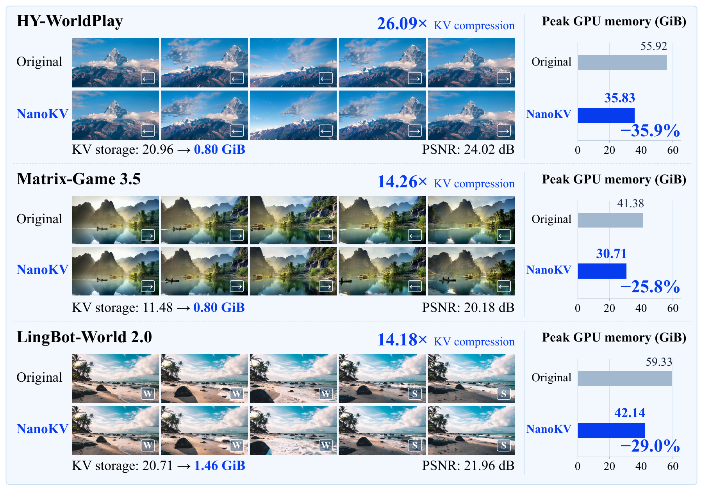
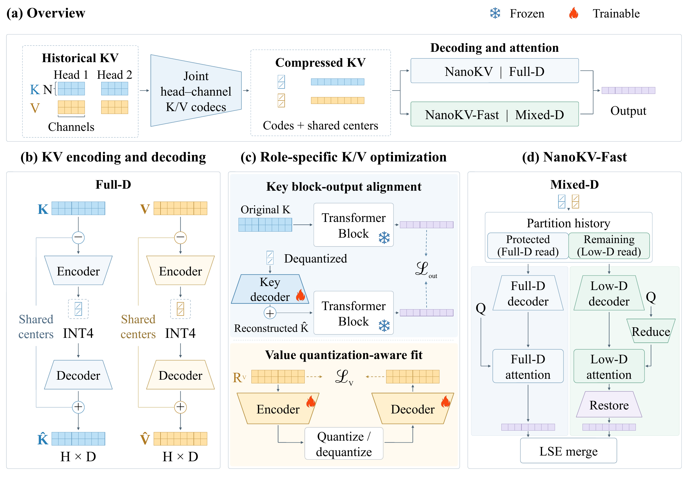

<h1 align="center">NanoKV: High-Ratio KV Cache Compression for Autoregressive Video Generation</h1>

<h3 align="center">Generation-aware KV compression with a frozen video backbone</h3>

<p align="center">
  Jiacheng Lu<sup>1</sup> · Haoyi Zhu<sup>2</sup> · Sipei Yi<sup>1</sup> ·
  Enze Xie<sup>2</sup> · Cheng Zhuo<sup>1</sup> · Yu Li<sup>1,*</sup><br>
  <sup>1</sup> Zhejiang University &nbsp; <sup>2</sup> NVIDIA &nbsp; *Corresponding author
</p>

<p align="center">
  <a href="https://jiacheng-lu03.github.io/NanoKV/"><b>🌐 Project Page</b></a> |
  <a href="https://huggingface.co/jiacheng1234/NanoKV"><b>🤗 Weights</b></a> |
  <a href="#quick-start"><b>🚀 Quick Start</b></a> |
  <a href="train/README.md"><b>🏋️ Training</b></a> |
  <a href="infer/README.md"><b>🎥 Inference</b></a> |
  <a href="#results"><b>📊 Results</b></a> |
  <a href="#citation"><b>📖 Citation</b></a>
</p>

<p align="center">
  <a href="LICENSING.md"></a>
</p>

**NanoKV is a frozen-backbone framework for generation-aware high-ratio KV compression.**
It preserves how compressed history affects video generation through different
fitting objectives for Keys and Values. Optional **NanoKV-Fast** reuses the same
compressed coefficients for mixed-dimensional attention.

<p align="center">
  <a href="docs/assets/teaser.png"></a>
</p>

<p align="center">
  <b>Up to 26.09× effective KV compression · Up to 35.9% lower peak GPU memory · Frozen video backbone</b>
</p>

The teaser shows example rollouts from the paper. Its PSNR annotations describe
the displayed examples; dataset-average quality is reported in the results below.

## 🔥 News

- **2026-11-04:** Released [NanoKV and NanoKV-Fast checkpoints](https://huggingface.co/jiacheng1234/NanoKV) for all three backbones.

- **2026-11-04:** Released NanoKV and NanoKV-Fast implementations for all three
  backbones, with data collection, codec fitting, reader fitting, inference,
  baseline configurations, and video-pair evaluation guides.

## ✨ Highlights

- **Generation-aware compression.** Optimize the effect of compressed history on
  downstream generation, beyond local KV reconstruction alone.
- **Different objectives for K and V.** Key block-output alignment preserves
  downstream features; Value quantization-aware fitting preserves low-bit
  reconstruction fidelity.
- **High effective compression.** On HY-WorldPlay, NanoKV achieves **26.09×**
  effective compression versus KVTC's **13.50×**, while improving reference PSNR
  from **18.56 to 19.56 dB**.
- **Optional attention acceleration.** NanoKV-Fast reduces historical-attention
  computation using the same stored coefficients, with a configurable mix of
  full- and low-dimensional reads.
- **Three backbone integrations.** HY-WorldPlay, LingBot-World 2.0, and
  Matrix-Game 3.5 share collection, training, and inference entrypoints.

<a id="method"></a>
## 🧩 How NanoKV Works

<p align="center">
  <a href="docs/assets/method.png"></a>
</p>

1. **Represent history compactly.** Store shared content in cluster centers and
   encode token-specific residuals jointly across heads and channels into
   low-bit coefficients.
2. **Fit Keys for their downstream effect.** Align Key decoder outputs through
   the frozen Transformer block, directly constraining block-output differences.
3. **Fit Values through quantization.** Optimize the Value encoder and decoder
   through the deployed quantization path to reduce low-bit reconstruction error.
4. **Choose how to read the cache.** NanoKV reconstructs full-dimensional KV.
   NanoKV-Fast uses fitted readers to construct mixed-dimensional features,
   retaining full-dimensional attention for protected history and sensitive
   heads or layers. Outputs from separate history partitions are merged.

| | NanoKV | NanoKV-Fast |
|---|---|---|
| Stored representation | Shared centers + low-bit residual coefficients | Same compressed coefficients |
| Attention access | Full-dimensional KV decoding | Mixed-dimensional KV decoding |
| Additional fitting | K/V codec fitting | Reader / projection fitting |
| Main objective | High-ratio compression with fidelity preservation | Lower attention computation with a quality–efficiency trade-off |
| Video backbone | Frozen | Frozen |

The model-specific fitting recipes are described in the
[training guides](train/README.md); the final head allocations and routing
settings are included in [configs/](configs/README.md).

<a id="results"></a>
## 📊 Main Results

Results at the paper's **nominal 32× coefficient-compression setting**.
Quality is averaged over **400 videos per configuration**: 100 VBench-I2V images
with four camera actions each. Runtime is measured on a **single NVIDIA A100**.
PSNR measures fidelity to the matched Original rollout.

| Backbone | Method | PSNR ↑ (dB) | Total KV ↓ (GiB) | Effective KV compression ↑ | E2E speedup vs. Original ↑ |
|---|---|---:|---:|---:|---:|
| HY-WorldPlay | KVTC | 18.56 | 1.55 | 13.50× | 0.92× |
| HY-WorldPlay | **NanoKV** | **19.56** | **0.80** | **26.09×** | 0.96× |
| HY-WorldPlay | **NanoKV-Fast** | 19.04 | 1.02 | 20.53× | **1.06×** |
| Matrix-Game 3.5 | KVTC | 18.83 | 1.24 | 9.28× | 0.57× |
| Matrix-Game 3.5 | **NanoKV** | **19.08** | **0.80** | **14.26×** | 0.92× |
| Matrix-Game 3.5 | **NanoKV-Fast** | 18.79 | 0.96 | 11.94× | **1.04×** |
| LingBot-World 2.0 | KVTC | 20.10 | 4.73 | 4.38× | 0.79× |
| LingBot-World 2.0 | **NanoKV** | **20.81** | **1.46** | **14.18×** | 0.93× |
| LingBot-World 2.0 | **NanoKV-Fast** | 20.68 | 1.78 | 11.62× | **0.98×** |

Effective compression includes additional storage; it differs from the nominal
coefficient budget. E2E speedup is Original latency divided by method latency.
See [full results and metric definitions](docs/RESULTS.md) for Original, QVG,
TurboQuant, KVTC, SSIM, LPIPS, and VBench.

### Attention computation with NanoKV-Fast

| Backbone | Historical-attention computation saved | All visual-attention computation saved |
|---|---:|---:|
| HY-WorldPlay | 37.93% | 32.31% |
| Matrix-Game 3.5 | 20.83% | 15.00% |
| LingBot-World 2.0 | 34.32% | 24.51% |

These percentages measure attention arithmetic at the nominal 32× setting.
End-to-end gains also depend on the attention runtime share and codec/reader
overhead: Fast exceeds Original's speed on HY and MG, and is slightly slower
on LingBot in the reported configuration.

<a id="models"></a>
## 📦 Supported Models and Artifacts

| Backbone | Command name | Profile length | Inference | Codec training |
|---|---|---:|---|---|
| HY-WorldPlay | `hy` | 253 frames | [Guide](infer/README.md#hy-worldplay) | [Guide](train/hy.md) |
| LingBot-World 2.0 | `lingbot` | 125 frames | [Guide](infer/README.md#lingbot-world-20) | [Guide](train/lingbot.md) |
| Matrix-Game 3.5 | `mg` | 169 frames | [Guide](infer/README.md#matrix-game-35) | [Guide](train/mg.md) |

Prepare the original backbone checkpoints using the upstream instructions
linked in the [setup guide](docs/SETUP.md). NanoKV uses a fitted `codec.pt`;
NanoKV-Fast additionally uses reader weights and their manifest.

**Download the released codecs and Fast readers from [Hugging Face](https://huggingface.co/jiacheng1234/NanoKV).**

| Backbone | Checkpoint directory | Manifest model name |
|---|---|---|
| HY-WorldPlay | [`hy-worldplay`](https://huggingface.co/jiacheng1234/NanoKV/tree/main/hy-worldplay) | `hy` |
| LingBot-World 2.0 | [`lingbot-world-2.0`](https://huggingface.co/jiacheng1234/NanoKV/tree/main/lingbot-world-2.0) | `lingbot` |
| Matrix-Game 3.5 | [`matrix-game-3.5`](https://huggingface.co/jiacheng1234/NanoKV/tree/main/matrix-game-3.5) | `mg` |

From the NanoKV code checkout, download one backbone (HY example):

```bash
hf download jiacheng1234/NanoKV --include "hy-worldplay/*" --local-dir ./checkpoints
export ARTIFACTS="$PWD/checkpoints/hy-worldplay"
(cd "$ARTIFACTS" && sha256sum -c SHA256SUMS)
```

For NanoKV-Fast, bind the reader manifest to your local download location:

```bash
python -m nanokv.prepare_artifacts --model hy \
  --artifacts "$ARTIFACTS" --output "$ARTIFACTS/manifest.json"
```

For another backbone, substitute its checkpoint directory and model name from
the table. To download all three, omit `--include "hy-worldplay/*"`.
See the [artifact guide](configs/README.md) and [inference guide](infer/README.md)
for profiles and generation commands.

<a id="quick-start"></a>
## 🚀 Quick Start

### 1. Clone and install

```bash
git clone https://github.com/jiacheng-lu03/NanoKV.git
cd NanoKV
```

Follow [environment setup](docs/SETUP.md) for your chosen backbone.
The integrations use separate Python 3.10 environments; compression and Fast
share the environment for a given model.

### 2. Generate a video with NanoKV

The following example uses HY-WorldPlay. After preparing the base model,
action-model checkpoint, and fitted codec, set your local paths:

```bash
conda activate nanokv-hy
export MODEL_PATH=/absolute/path/to/HunyuanVideo-1.5
export ACTION_CKPT=/absolute/path/to/action_model/model.safetensors
export ARTIFACTS=/absolute/path/to/hy_artifacts
export INPUT_IMAGE=/absolute/path/to/input.png
export RUN_DIR="$(pwd)/outputs/first_run"
mkdir -p "$RUN_DIR"

python -m nanokv.prepare_profile --model hy --artifacts "$ARTIFACTS" \
  --output "$RUN_DIR/nanokv.json"

CUDA_VISIBLE_DEVICES=0 python infer/run.py hy generate \
  --profile "$RUN_DIR/nanokv.json" -- \
  --model_path "$MODEL_PATH" --action_ckpt "$ACTION_CKPT" \
  --image_path "$INPUT_IMAGE" --prompt "A mountain landscape" \
  --pose left-31,right-32 --output_path "$RUN_DIR/nanokv"
```

The video is written to `$RUN_DIR/nanokv/gen.mp4`. Use a fresh run directory
for another run; profile creation refuses to overwrite an existing file.
For LingBot or MG, follow the model-specific commands in the
[inference guide](infer/README.md).

<details>
<summary><b>Run NanoKV-Fast with the same HY codec</b></summary>

After [fitting and assembling the readers](train/fast.md), point to their manifest:

```bash
export READER_MANIFEST=/absolute/path/to/assembled_readers/manifest.json
python -m nanokv.prepare_profile --model hy --variant fast \
  --artifacts "$ARTIFACTS" --manifest "$READER_MANIFEST" \
  --output "$RUN_DIR/fast.json"

CUDA_VISIBLE_DEVICES=0 python infer/run.py hy generate_fast \
  --profile "$RUN_DIR/fast.json" -- \
  --model_path "$MODEL_PATH" --action_ckpt "$ACTION_CKPT" \
  --image_path "$INPUT_IMAGE" --prompt "A mountain landscape" \
  --pose left-31,right-32 --output_path "$RUN_DIR/fast"
```

The binder verifies that the reader manifest matches the codec. Both runs use
the same input image, prompt, camera actions, and profile generation settings.

</details>

All commands run from the repository root. Use **absolute paths** for your
weights, data, and outputs. Arguments before `--` belong to the shared
launcher; arguments after it belong to the native model.

<a id="training"></a>
## 🏋️ Train NanoKV and NanoKV-Fast

The video backbone remains frozen throughout fitting.

```text
Images + prompts + actions
          │
          ▼
   Collect KV samples
          │
          ▼
   Fit residual bases
          │
          ▼
   Fit K/V codecs ───────────────► Export codec.pt ─────► NanoKV
                                         │
                                         ▼
                               Collect attention samples
                                         │
                                         ▼
                                Fit and assemble readers
                                         │
                                         ▼
                                    NanoKV-Fast
```

| Stage | What it produces | Instructions |
|---|---|---|
| KV collection and residual fitting | Paired KV samples and residual bases | [HY](train/hy.md) · [LingBot](train/lingbot.md) · [MG](train/mg.md) |
| Role-specific codec fitting | Fitted K/V components and packed `codec.pt` | [Training overview](train/README.md) |
| Fast reader fitting | Reader experts, fixed allocation, and manifest | [Fast guide](train/fast.md) |
| Inference configuration | Profile bound to your codec and readers | [Artifact guide](configs/README.md#locally-trained-artifacts) |

The guides specify split formats, expected sample counts, fitting commands, and
the outputs consumed by each subsequent stage. Keep fitting and evaluation
images separate, including all action trajectories from the same image.

<a id="evaluation"></a>
## 🔬 Evaluate and Compare

Profiles for **Original, QVG, TurboQuant, and KVTC** are included alongside
NanoKV and NanoKV-Fast. Use identical images, prompts, actions, seeds, frame
counts, and resolution for paired comparisons. Baseline-specific prerequisites
are listed in the [inference guide](infer/README.md#baselines).

After generating an Original reference and a compressed video:

```bash
python -m pip install lpips torchmetrics scikit-image
python eval/video_pair.py \
  --reference /absolute/path/to/original.mp4 \
  --candidate /absolute/path/to/nanokv.mp4 \
  --output /absolute/path/to/metrics.json
```

The evaluator reports per-frame PSNR, SSIM, and LPIPS, with both all-frame and
generated-frame means. The latter excludes the shared input frame.
The paper's VBench results average subject consistency, background consistency,
motion smoothness, aesthetic quality, and imaging quality.

## 📚 Documentation

| I want to… | Start here |
|---|---|
| Install a model environment and obtain its backbone | [Setup](docs/SETUP.md) |
| Generate a video with NanoKV or Fast | [Inference](infer/README.md) |
| Collect fitting samples and train a codec | [Training](train/README.md) |
| Fit low-dimensional attention readers | [NanoKV-Fast training](train/fast.md) |
| Use my own fitted weights | [Profiles and artifacts](configs/README.md) |
| Compare numerical results with the paper | [Results](docs/RESULTS.md) |
| Find the native implementation or extend it | [Model layout](models/README.md) |

<details>
<summary><b>Repository layout</b></summary>

```text
NanoKV/
├── nanokv/        Shared launch and artifact-binding utilities
├── models/        Three backbones, each with compression/ and fast/
├── configs/       Budgets, routing policies, and inference profiles
├── train/         Collection, fitting, and reader export
├── infer/         Inference entrypoint and model-specific instructions
├── eval/          Frame-aligned video metrics
└── docs/          Setup, results, paper figures, and project page
```

</details>

## ✅ Release Status

- [x] NanoKV and NanoKV-Fast integrations for all three backbones
- [x] KV collection, codec fitting, and export
- [x] Fast attention-sample collection, reader fitting, and assembly
- [x] Inference profiles and baseline configurations
- [x] Video-pair evaluation and reproduction guides
- [x] [Hugging Face codec and reader checkpoints](https://huggingface.co/jiacheng1234/NanoKV)

## ❓ FAQ

<details>
<summary><b>Does NanoKV require fine-tuning the video generator?</b></summary>

The original video backbone is frozen. NanoKV fits separate codec parameters;
NanoKV-Fast also fits low-dimensional reader/projection parameters. Follow the
model-specific recipes for the components used by each backbone.

</details>

<details>
<summary><b>Why is effective KV compression smaller than the nominal 32× budget?</b></summary>

The nominal budget describes the coefficient representation. Effective KV
compression also accounts for centers, indices, scales, operators, and any
protected full-dimensional history, as specified by the paper's storage accounting.

</details>

<details>
<summary><b>Why is the attention-computation saving larger than the end-to-end speedup?</b></summary>

Fast accelerates historical attention. Other generation stages still take time,
and codec decoding and feature mappings add overhead. Use the E2E column for
whole-video runtime comparisons and the computation table for attention arithmetic.

</details>

<a id="citation"></a>
## 📖 Citation

If you use NanoKV in your research, please cite:

```bibtex
@misc{lu2026nanokv,
  title={NanoKV: High-Ratio KV Cache Compression for Autoregressive Video Generation},
  author={Jiacheng Lu and Haoyi Zhu and Sipei Yi and Enze Xie and Cheng Zhuo and Yu Li},
  year={2026},
  url={https://github.com/jiacheng-lu03/NanoKV}
}
```

## 🤝 Acknowledgements and Licenses

This implementation builds on
[HY-WorldPlay](https://github.com/Tencent-Hunyuan/HY-WorldPlay),
[LingBot-World](https://github.com/Robbyant/lingbot-world),
[Matrix-Game](https://github.com/SkyworkAI/Matrix-Game), and their dependencies.
We thank the authors of the baseline methods and VBench for their work.

NanoKV's independent original utilities, configurations, and associated
documentation are released under the [MIT License](LICENSE). See
[license scope](LICENSING.md) for the exact covered paths and exclusions.

Model integrations under `models/` retain their upstream terms: **HY-WorldPlay's
Tencent Community License**, **LingBot's CC BY-NC-SA 4.0**, and **Matrix-Game's
Apache-2.0**, with separately licensed dependencies retaining their own notices.
The root MIT license does not override these terms or apply to the entire
repository. See [THIRD_PARTY_NOTICES.md](THIRD_PARTY_NOTICES.md). Backbone weights
remain subject to their respective upstream terms.
